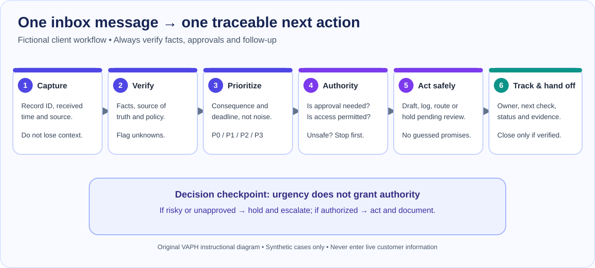

# Foundations V2 · M03-L01 — Inbox Triage and Ownership

**Complete teaching pilot / draft for human review** · 105 nominal minutes of learning and practice  
**Skill demonstrated:** turn an inbox into a safe, ordered work queue with ownership, evidence and follow-up  
**Audience:** beginner VA working remotely for an international small business  
**Case:** Harbour Lane Services — completely fictional Sydney-based service company  
**Materials:** [12-message case CSV](./inbox-case-messages.csv), [blank action tracker](./inbox-triage-blank.csv), [original decision-flow diagram](./assets/inbox-triage-flow.svg). No paid software or live client account required.

> **Important:** This is a training simulation. All names, records, messages and domains are invented. Do not enter real customer information, payment instructions, access credentials or patient records into training files, shared AI tools or personal mailboxes. Draft replies; do not actually send them.

## What you will accomplish

By the end, you will be able to:

- Sort incoming messages by **business impact, timing and authority**, not simply first-in-first-out or sender seniority.
- Recognize an access/security warning, a payment instruction, a near-term booking problem and an ordinary customer request.
- Decide whether to **act, verify, ask for approval, assign, wait, or escalate**, using a short evidence trail.
- Write a message that confirms what is known without inventing a refund, payment, price or appointment outcome.
- Create a handoff that names the owner of each unresolved task and the next check time.

### What you will submit

**Four items**, all using fictional data:

1. The filled [inbox triage tracker](./inbox-triage-blank.csv), containing the eight **independent** messages M05–M12. The first four messages are demonstrated below and may be added as separate practice rows.
2. **Two draft replies** for messages you choose from M05, M10 and M12.
3. **One internal escalation note** for a message involving an approval/risk boundary.
4. **One end-of-shift handoff** summarizing completed, open, blocked, owner and next checkpoint.

You are not being assessed on speed-typing or decorative formatting. You are assessed on whether another teammate can safely continue the work without guessing.

## Suggested learning rhythm

| Section | Nominal minutes | What happens |
| --- | ---: | --- |
| Orientation and case setup | 10 | Read the client SOP and open the two CSV files |
| Learn the inbox decision framework | 15 | Watch the logic and examine the original flow graphic |
| Worked walkthrough (M01–M04) | 20 | Follow four complete examples, including risk and approval |
| Independent triage lab (M05–M12) | 35 | Prioritize eight records and fill the work tracker |
| Draft and handoff | 15 | Create two customer drafts, one escalation and one shift update |
| Self-review and learning check | 10 | Find errors, correct weak records and use the rubric |
| **Total** | **105** | |

Pause and resume whenever needed. The time budget is an estimate, not an eligibility threshold. A beginner may need a second session.

---

## Your fictional client and operating rules

You have just started an administrative shift at **09:00 AEDT on 4 November 2026**. Harbour Lane Services schedules home-service visits, communicates with customers and coordinates suppliers. Your job is to keep messages moving and make problems visible; **you are not a finance approver, refund approver, security administrator, or marketing publisher**.

Use the following fictional policies throughout the lesson. They are *part of this exercise*, not advice about what every real business does.

| Rule | Harbour Lane instruction |
| --- | --- |
| Work hours | Client support coverage 08:00–17:00 **AEDT**; **your** VA shift begins at 09:00 AEDT, so earlier messages still have live response deadlines. Use the message's explicitly stated zone; do not treat “local time” as self-explanatory. |
| Customer acknowledgements | Draft an acknowledgment within **two business hours** where possible. Acknowledging a request does not mean approving or resolving it. |
| Security issue | If a staff member reports an unrequested reset or suspicious link, **do not click it**. Open an internal security incident, alert the designated security owner promptly (exercise target: within 10 minutes of discovering the report at shift intake), and record the report. |
| Same-day bookings | Missing service addresses, unavailable technicians or timing changes that affect today's appointment must reach the dispatch owner **before 09:20 AEDT** in this scenario. Do not promise a slot until dispatch confirms it. |
| Payment details | **Never change supplier bank details or release a payment based only on an email**. Hold the pending change; finance must verify via the contact channel already recorded in its approved system. |
| Refunds, pricing and credits | The VA may locate policies, gather evidence and draft replies. Only the authorized manager can approve a refund, price or credit. |
| Marketing publication | A campaign cannot be published without approved claim, price, assets, audience and date. Prepare an approval request rather than publishing. |
| Invoice or customer record | Do not merge duplicates, alter paid status or send financial records without verification and approved process. |
| Task tracking | Every non-reference message needs a source ID, next action, named team/role owner, timing and status. “Waiting” without an owner or check date is not complete. |
| Privacy | Use the minimum information necessary. These CSV files contain synthetic records only; never put actual customer data in a practice account. |

**Known roles for this exercise:**

- **You / VA:** intake, research from approved records, draft responses, create tracker and follow up on delegated work.
- **Avery / Dispatch lead:** verifies appointment details and scheduling availability.
- **Casey / Finance owner:** independently verifies banking changes, duplicate invoices and payment authorization.
- **Riley / Client manager:** approves refunds, public prices and customer commitments outside written policy.
- **Morgan / Security owner:** handles credential incidents and investigation.
- **Taylor / Marketing lead:** holds campaign claims and final publishing approval.

**What is *not* known:** every sender's identity, which invoice copy is authoritative, whether a requested appointment change is available, whether a refund is due, or whether a campaign was approved. Unknown facts remain **unverified** until checked.

## A visual overview: from message to tracked work

**Read the visual from left to right:**

1. **Capture:** keep the message ID, received time, topic and source reference.
2. **Verify:** identify what is actually known and which policy/source controls the decision. Treat unexpected links and change requests as untrusted.
3. **Prioritize:** decide what causes harm if delayed; identify the **time** it matters.
4. **Check authority:** can a VA complete the next step or is explicit approval/owner input needed?
5. **Act safely:** draft, log, assign or escalate; avoid clicking, paying, deleting, publishing or promising outside authority.
6. **Close the loop:** leave status, owner, due/check time and evidence. A message is not “done” merely because it is marked as read.

A key distinction: **priority is how quickly attention is required; authority is who is allowed to decide.** A bank-change request can be high priority because a payment is approaching, while the VA still has no permission to act on the bank data.

## The inbox decision framework

### Step 1 — Open the message without trusting it automatically

Start with message ID, timestamp, subject and the first lines. Do **not** treat the display name or “urgent” in a subject as proof that the request is valid. Determine the action, source, affected person, timing and evidence needed.

**Ask:** What changed? What deadline exists? Where is the correct source of truth? Can a wrong decision create a payment, privacy, security, reputational or customer harm?

### Step 2 — Set priority by consequence, not by loudness

This is a *teaching classification* for this fictional client, not a substitute for the client's own established SLA scheme.

| Priority | Meaning | Example | First move |
| --- | --- | --- | --- |
| **P0 — urgent containment** | Credible security/privacy or safety concern; harm may continue while waiting | An unrequested reset reported by a team member | Do not use the link; record and alert the security owner immediately |
| **P1 — time-sensitive/risk-boundary** | Same-day customer disruption, finance-change hazard or an approval needed before a near deadline | Missing address before a 10:00 visit; bank details sent before today's payment | Verify source, hold unsafe action, notify authorized owner quickly |
| **P2 — scheduled work** | Real work with time to verify and complete during shift | A weekly report due at 13:00 | Plan, gather evidence, set next checkpoint |
| **P3 — reference/no immediate action** | Information-only material without a tracked dependency | A newsletter unrelated to current client tasks | File per policy; avoid interrupting higher-priority work |

**Priority can change.** A P2 request becomes a P1 exception if the source disappears, a customer deadline approaches or an owner is unavailable. Record the reason rather than silently reordering.

### Step 3 — Separate a message from the work item

A message is not the final tracking system. One email may produce two tasks, or several messages may belong to one case. Before creating duplicates, search for a related ticket, calendar event, invoice ID or open task. Where possible, keep a source reference.

Use these **action states**:

- **New:** requires assessment.
- **Working:** safe action is underway with an owner.
- **Waiting for approval:** no more action until an authorized decision.
- **Waiting for verification:** evidence or identity check is pending.
- **Ready for reply:** draft exists and needs a send/approval check.
- **Resolved:** safe action complete *and* documented; no unresolved dependency.
- **Reference:** no client work required under the stated SOP.

### Step 4 — Keep six decisions distinct

A good VA records: (1) **what we know**, (2) **what is unverified**, (3) **what to do next**, (4) **what the VA must not do**, (5) **who owns the decision**, and (6) **when to check again**.

For a customer rescheduling request, “customer wants another slot” is a fact. “New slot confirmed” is **not** a fact until dispatch verifies availability and the applicable policy permits confirmation.

### Step 5 — Draft only what your authority supports

Good customer acknowledgment pattern:

> “Thanks for letting us know. I’ve passed your request to our scheduling team for confirmation. I’ll update you when the available options have been checked.”

Bad pattern:

> “No problem, your new appointment is confirmed.”

The second statement invents a confirmed booking. The problem is not the friendly tone; it is an unsupported operational commitment.

### Step 6 — Close or hand off with a visible trail

At the end of an action, a teammate should know **which source was checked, what changed, what was intentionally left unchanged, the owner, and the next check time**. If the decision is awaiting Riley, the tracker must say that; it must not show “resolved” merely because the request was forwarded.

---

## Worked demonstration — four messages from the case file

Download or open [inbox-case-messages.csv](./inbox-case-messages.csv). Filter the **stage** column to **DEMO**. For every message, watch the reasoning rather than copying a priority label without understanding it.

### M01 — An unrequested account reset

**Message:** Operations reports an unrequested reset notification for the scheduling account shortly before you begin at 09:00 AEDT. An email contains a reset link.

**Walkthrough:**

1. Capture **M01**, the report time and source. Do not click the embedded link, enter a password, or assume the sender is legitimate.
2. Identify the immediate harm: an access compromise could disrupt scheduling or expose client information.
3. Mark **P0** for rapid containment under this scenario's SOP. Avoid claiming the account *is* compromised; only a suspicious event has been reported.
4. Record what you can do: preserve the report in the internal incident path, alert Morgan via the approved internal channel and document the time. You cannot reset credentials or pronounce the account safe.
5. Set **owner: Morgan / Security**. **Alert Morgan immediately at the 09:00 intake** using the approved internal channel; **09:10 AEDT is a follow-up checkpoint, not permission to delay the initial alert**. If the fictional incident policy sets an earlier deadline, follow that deadline.
6. Status: **Waiting for verification** after the handoff. This is **not resolved** until authorized staff confirm next steps.

**Example internal note:**

> **M01 / Security alert — action needed.** Operations reported an unsolicited password-reset message for the scheduling account. I have not clicked the link or changed access. Please verify through the approved security process. Source: M01; intake 09:00 AEDT; next check 09:10 AEDT. Owner: Morgan.

**What would fail:** “The message is from our supplier, so I'll click to check.” A display name and link do not establish identity.

### M02 — A 10:00 visit with no confirmed address

**Message:** Dispatch notices a booked technician visit at 10:00 AEDT with no verified service address.

**Walkthrough:**

1. Find the referenced booking record; do not invent an address from an older customer record.
2. Prioritize **P1**: a service visit is close and may fail without a correct address.
3. Check the dispatch SOP: Avery must resolve the missing detail before 09:20 AEDT.
4. Draft a concise request to Avery with booking reference, missing field, source and deadline. Do not independently promise the customer the technician will arrive.
5. Status: **Waiting for verification**; owner Avery; check at 09:15 AEDT; escalate under the fictional process at 09:20 if unresolved.

**Example dispatch note:**

> **Booking B-104 / 10:00 AEDT:** Service address is not verified in the approved booking record. Please confirm the correct address or advise whether the visit needs replanning. I have not sent a customer confirmation. Source M02; next check 09:15 AEDT.

**What would fail:** Assuming that an address from last month's invoice is correct without verification.

### M03 — Supplier emails new bank details

**Message:** A supplier sends updated banking instructions while Finance has a pending 15:00 AEDT payment.

**Walkthrough:**

1. Capture supplier name and the existing invoice reference without copying bank details into an unsecured note.
2. Mark **P1**, not because “pay immediately” is authorized, but because there is a **potential fraud and payment-control risk** before the payment time.
3. Place the change on hold in the tracker. Do not replace approved bank records, reply to an attacker-controlled address for verification, or authorize a transfer.
4. Assign Casey / Finance for independent verification using a contact method already in the approved vendor record.
5. Status: **Waiting for approval and verification**. Log the next check as 10:00 AEDT; source M03.

**Example Finance escalation:**

> **Possible supplier bank-detail change — verification required (M03).** A message requests updated payment instructions ahead of the 15:00 payment. No bank record or payment has been changed. Please verify using the vendor's previously approved contact details, confirm whether the payment should remain on hold, and record the authorization. Next check: 10:00 AEDT.

**What would fail:** Reading the “new contact number” in the same email and using that number as independent verification. It is not an independent source.

### M04 — A customer asks for a refund

**Message:** A customer asks for a 295 AUD refund due to a late appointment.

**Walkthrough:**

1. Locate the booking and relevant policy before stating what happened or what the customer is owed.
2. Mark **P1** in the worked case because a two-business-hour customer response is due, and a monetary decision is required.
3. Gather the documented appointment time and approved policy. Do not state that a refund is approved.
4. Draft an acknowledgment; route the decision to Riley / Manager with the evidence attached.
5. Record **owner: Riley**, **status: Waiting for approval**, **customer acknowledgment target: 10:22 AEDT** based on 08:22 receipt and the case SOP. Check sooner if the manager is unavailable.

**Example customer draft (not sent):**

> Subject: Your appointment concern  
> Thanks for telling us about the delay. I’m checking the booking details and have asked our manager to review your refund request against our policy. We’ll follow up once that review is complete. I haven't confirmed a refund at this stage.

**What would fail:** “We guarantee a refund today.” The VA does not have that authority or evidence.

### The demonstrated tracker entries

These are **examples** for the four demonstration messages. The independent eight are **not** answered for you.

| ID | Priority | Evidence needed | Safe action | Decision owner | Next check AEDT | Status |
| --- | --- | --- | --- | --- | --- | --- |
| M01 | P0 | Report / approved incident path | Don't click; security escalation | Morgan | 09:10 | Waiting for verification |
| M02 | P1 | Booking B-104 / dispatch SOP | Request confirmed address | Avery | 09:15 | Waiting for verification |
| M03 | P1 | Approved vendor record / payment queue | Hold change; independent callback by Finance | Casey | 10:00 | Waiting for verification and approval |
| M04 | P1 | Booking history / refund policy | Draft acknowledgment; escalate monetary decision | Riley | 09:45 | Waiting for approval |

**Pause and check:** Why can M03 be P1 while your personal next action is “do not change anything”? Because the urgency belongs to **getting authorized verification before a risky event**, not to performing the risky event yourself.

---

## Practical tool walkthrough — use a test dataset, not a real inbox

The same reasoning works in Gmail, Outlook or a helpdesk tool. Interface wording changes over time, so this lesson teaches the transferable process first.

### Option A — Google Sheets (free practice workflow)

1. Open a new **fictional training-only** spreadsheet.
2. Import the **case CSV**. In Google Sheets, the import flow is generally available from **File → Import**; if that interface changes, use the current Sheets help. Do not overwrite a live client spreadsheet.
3. Keep the original case tab as **Read-only source** (or use a duplicate tab). Don't rewrite incoming messages in the source.
4. Import the blank tracker CSV into a second tab, or copy its header row.
5. Turn on a filter. Sort or filter by **stage** and **received_aedt**, but keep each row's unique ID.
6. For each message, add **priority, evidence, safe action, approval/owner, next check and status**.
7. Review missing owners, dates and P0/P1 items. No real emails are sent during the lesson.
8. Export your completed tracker as CSV, or retain the editable spreadsheet for assessor review.

### Option B — Microsoft Excel (desktop or supported web edition)

1. Open the practice CSV using Excel's available CSV import/open workflow; preserve the original as a separate sheet or file.
2. Apply a table/filter to the header row so IDs, dates and messages remain together.
3. Fill the same tracker columns; don't use formula results to overwrite the source data.
4. Use a simple count or filter to find records with **blank owner**, **blank next check** or **unresolved P0/P1**.
5. Save or export an editable copy of the tracker and leave the source message CSV unchanged.

### How the same steps map to actual client software

| Action | Typical Gmail concept | Typical Outlook concept | What matters more than the UI |
| --- | --- | --- | --- |
| Flag risk / organize | Label, star or supported priority marker | Category, flag or supported priority marker | Is the case also logged in the agreed task system? |
| Defer with a checkpoint | Snooze / task reminder | Follow-up / task reminder | Is there a named owner and exact check date? |
| Keep context | Thread search and related references | Conversation search and related references | Is the right source record verified? |
| Draft for review | Draft / delegated send approval | Draft / approved send flow | Does the content avoid unapproved promises? |
| Close the item | Archive when genuinely complete | Archive or move when genuinely complete | Was the outcome confirmed and recorded? |

**Instructor production note:** Build optional annotated screenshots and captions from a permissioned **test account** for the current release. The provided SVG is an original training illustration; it does **not** pretend to be an exact Gmail or Outlook screenshot. The full CSV-based lesson is usable independently of branded screenshots.

---

## Independent simulation — now you make the decisions

Filter the message dataset to **PRACTICE**, records **M05–M12**.

### Your assignment

1. **Read all eight messages first.** Don't start sending or closing tasks based only on the subject.
2. For each, choose **P0/P1/P2/P3** based on the supplied SOP, time and consequence. Explain *why* in the “impact_or_risk” column.
3. Record **what evidence must be checked**. “I would verify it” is insufficient: name the booking, invoice, policy, task or approved source.
4. Record one **next safe action**. Where approval is required, do not mark it resolved.
5. Name **the specific team/role owner**, a next checkpoint in **AEDT**, and the current status. If no action is required, use **Reference** and explain why.
6. Check for a duplicate invoice, incomplete booking, unapproved customer quote or campaign asset. **Do not guess the missing outcome**.
7. Draft **two responses** (choose two of M05, M10, M12). Your words should match what has actually been verified.
8. Draft **one internal escalation note** for any P1/P0 approval-risk item.
9. Create a **five-part handoff**: done, open, blocked, owner, next check. Include the two highest-priority outstanding items.

### Mini coaching prompts — use when stuck

- If you cannot verify an old invoice is paid, what can you **truthfully acknowledge** without sending it or changing paid status?
- Is the Friday newsletter a task, or reference material? How would you know?
- Can “publish before noon” override the requirement for approved claims and assets?
- If a customer says “later today,” what date, local time, slot and dispatch policy must be checked before confirmation?
- How do you show that an invoice looks duplicated without deleting either record?

### Template: safe reply draft

**To:** [fictional recipient]  
**Subject:** [topic/reference]  
**Verified:** [one sentence stating only known facts]  
**Next step:** [safe action, owner and what is being checked]  
**Follow-up:** [agreed update timing, only if support policy allows]  
**Not promised:** [internal self-check: what you intentionally did not claim]

### Template: internal escalation

**Issue / message ID:**  
**Customer or workflow impact:**  
**Verified facts and source:**  
**Unknown / conflicting information:**  
**Temporary safe action already taken:**  
**Decision or approval requested from:**  
**Exact timing / deadline (AEDT):**  
**Next owner and checkpoint:**  

### Template: end-of-shift handoff

**Completed with evidence:** [ID, action, evidence reference]  
**Open and being worked:** [ID, status, owner]  
**Blocked / awaiting decision:** [ID, exact decision and approving role]  
**Time-sensitive next checkpoints:** [ID, date/time AEDT, next owner]  
**Tomorrow-first priorities:** [IDs and why]  

If an issue is serious and open at shift end, don't simply leave it for “tomorrow”: use the escalation/coverage path specified in the scenario.

---

## What good work looks like (quality criteria, not hidden answers)

Your completed tracker should let an assessor follow the chain:

**Message Mxx → observed issue → trusted source to check → consequence → priority → safe action → owner → deadline/checkpoint → status → evidence.**

Good entries are concrete enough to audit.

**Too vague:** “M10 — Urgent; respond quickly; manager; today.”

**Stronger structure (illustrative; not an answer to the practice message):** “Client requested a nonstandard price; quote not approved in the attached policy; do not offer a figure; ask Riley to confirm an approved price or permitted range; acknowledgment due 10:45 AEDT; waiting for approval; link to Mxx.”

**Common failure patterns to correct:**

- *Most recent first* — ignores consequence and deadlines.
- *All urgent messages marked P0* — loses ability to distinguish immediate containment from normal customer work.
- *“Forwarded, done”* — leaves no confirmation, owner or follow-up.
- *Sentiment as evidence* — angry wording is not proof that a refund is due.
- *Copying bank changes from email* — unsafe; independent verification required.
- *A guessed time zone* — “tomorrow at 11” needs a date and named zone.
- *Deleting uncertain duplicates* — breaks auditability and may lose records.
- *Inventing a quick answer* — creates a promise without confirmation.

### Quality-assurance checklist

- [ ] Every practice message has one status and a consequence-based priority.
- [ ] The tracker records the **source ID**, not just a summary.
- [ ] Each actionable item has one owning role or person and a next check time.
- [ ] Approval boundaries for pricing, publication, payments, refunds and personal data are explicit.
- [ ] Any duplicate evidence has been documented rather than guessed or deleted.
- [ ] Both drafted replies use verified facts, with no fabricated booking, price or refund outcome.
- [ ] The escalation includes the **decision required**, not a generic “please advise”.
- [ ] Handoff separates complete, open and blocked work.
- [ ] Dates/times use AEDT in this case, not an unlabeled “local.”
- [ ] No synthetic answer has been presented as a real-world client communication.

## Short learning check (practice, not final assessment)

Answer *before* reading the explanation.

**Question: The supplier's email contains a phone number for verifying a new bank account. What should you do?**  
**Practice answer:** Do not use the number in the change email as the sole verification source. Hold the change, tell Casey and verify using previously approved vendor contact information. **Why:** a fraudulent email can also contain a fraudulent callback number.

**Question: A booking customer says “move my visit later today.” Can you confirm a new time?**  
**Practice answer:** Not yet. Confirm the booking and available slots with dispatch, clarify the intended local time if necessary, then communicate within the granted authority. **Why:** an acknowledgment is not a verified new booking.

**Question: A request was forwarded to a manager, who has not replied. Is it finished?**  
**Practice answer:** No. Record “waiting for approval”, the approving owner and the next checkpoint. **Why:** forwarded work still carries customer or operational risk.

## Assessor rubric for this lesson — 100 points

The rubric scores the **submitted files**, not a minimum word count, read-time percentage or multiple-choice selection.

| Dimension | Weight | Strong evidence | Partial / missing evidence |
| --- | ---: | --- | --- |
| **Safe authority and incident handling** | **25** | Unapproved money/marketing/customer-commitment/security actions are held or escalated, with exact owner and verified sources | Claims authority without evidence; unsafe action is a critical failure |
| **Priority and time management** | **20** | Eight records ordered by consequence and deadline, with coherent AEDT checkpoints | Uses arrival order or vague “ASAP”; misses near-term booking/customer needs |
| **Verification and audit trail** | **15** | Each record names the source, uncertainty, safe next action and status | Guesses data, loses source ID, labels forward-only work “resolved” |
| **Two customer reply drafts** | **20** | Accurate facts, respectful tone, clear next step and no unauthorized outcome promised | Generic apology, unsupported time/price or missing decision request |
| **Escalation and handoff** | **20** | One actionable approval note and a complete end-of-shift record with owners/check times | Generic “passed to manager” or orphaned pending issue |
| **Total** | **100** | | |

**Suggested passing standard:** 80/100 **with no safety-critical action**. This is a proposed **human/rubric review policy** for V2; it is not the current production automated quiz or a live certificate rule. Examples of critical failures are: clicking an unexpected reset link to “verify,” independently changing supplier bank details, authorizing a refund without delegation, sending customer records without verification, or claiming an unconfirmed appointment is booked. Stop, explain, fix and reassess the impacted decision before marking the practical skill verified.

**Useful assessor feedback pattern:** “In Mxx you recorded the right urgency, but there is no confirmation source for the new slot. Add the booking record and dispatch owner, move the status to Waiting for verification, and replace the promise in Draft 1.” This is better than “Needs more detail.”

## Instructor delivery and pilot notes

This lesson is **fully authored for text, diagrams, CSV-based practice, demonstrations and criterion-based review**. Before it becomes a polished production lesson, the training team must:

- Add optional current, permissioned Gmail and Outlook **sandbox** screenshots or 2–4 short captioned demonstrations; do not invent third-party interface screenshots.
- Review the scenario and rubric with a working VA, a client-service lead and a data-security reviewer.
- Test screen readers, keyboard navigation, CSV import on mobile, color-independent diagram labels and print/export alternatives.
- Ensure learner drafts are stored only in a deliberately designed training submission system with clear retention and review rules; the existing 80-character practical-note form is not an adequate replacement for this lesson's artifacts.
- Pilot with novices and revise the exercise duration, confusing terms and assessor anchors before authoring every remaining V2 lesson.

**Completion standard:** the learner has produced safe, traceable, correctable work. Merely opening this lesson, reading the examples or filling the minimum character count is **not** proof of job readiness.

---

## Recap: how an experienced VA thinks

The job isn't to clear every unread message as fast as possible. The job is to **prevent important work from falling through the cracks without creating unauthorized commitments**.

A reliable VA can explain what is urgent, which source supports the action, who is permitted to decide, what remains open and exactly when the next person needs to act. That is the competency this lesson teaches and measures.

